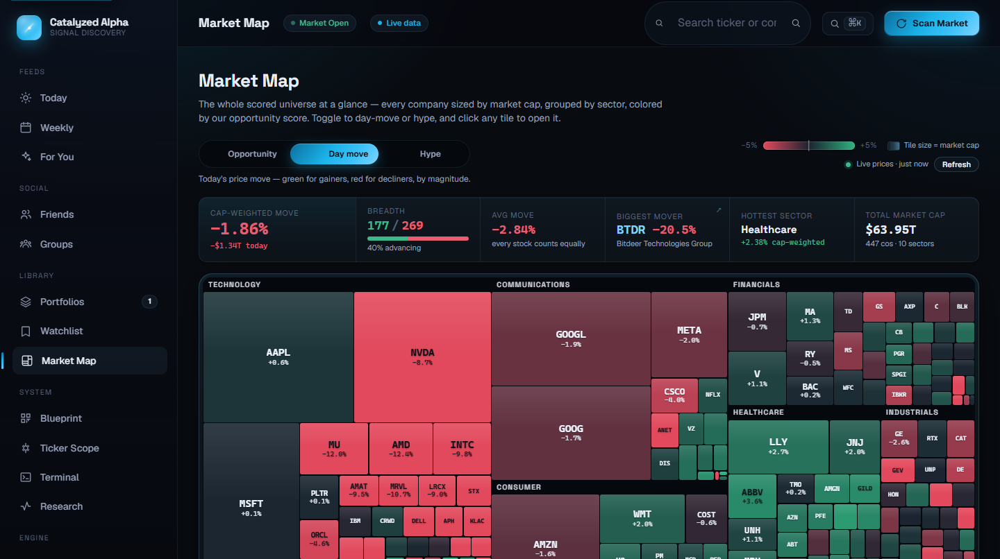
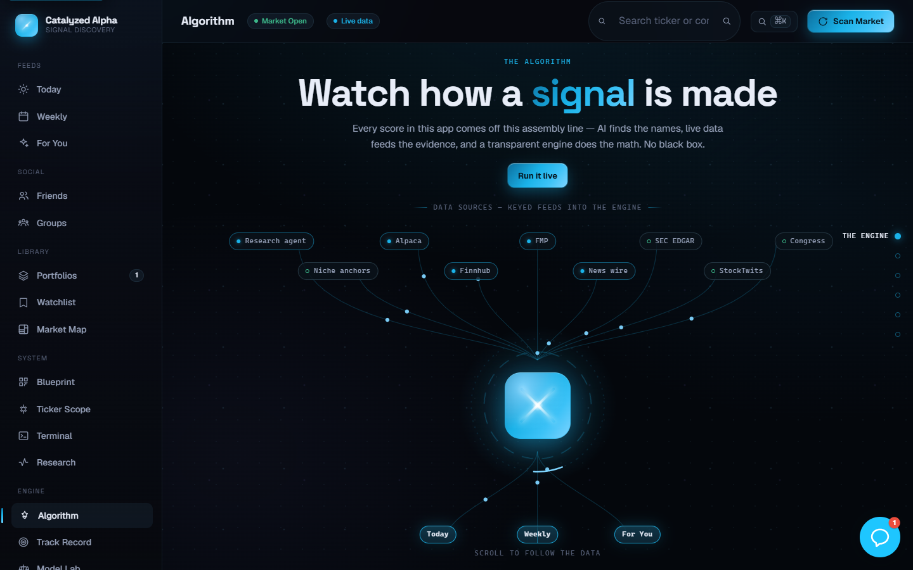
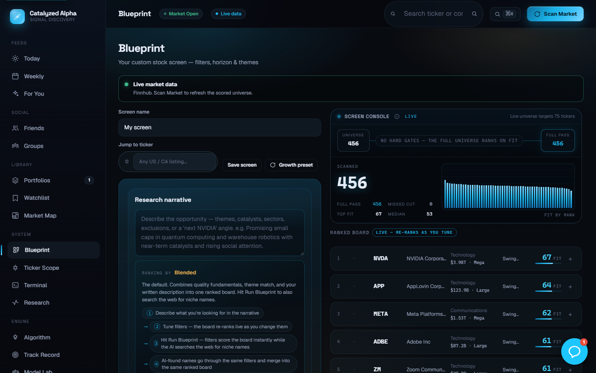

# Catalyzed Alpha

Equity research platform with built-in AI. One TypeScript codebase builds a web app and a desktop app on Tauri, a Rust desktop framework. Every morning, a scheduled job takes about 21,000 US listings, filters them to about 500, scores each on 13 dimensions and ranks them against each other with a deterministic engine. Language models collect evidence and write the research. The engine computes every score.

Live at [catalyzed-alpha.vercel.app](https://catalyzed-alpha.vercel.app).



| Measured in this repository | |
|---|---|
| TypeScript (`.ts`, `.tsx`, `.mts`) | 127,648 lines |
| Vitest tests | 1,877 in 188 files |
| Postgres | 26 tables, 28 migrations, row-level security on 26 of 26 |
| Supabase edge functions | 4 |
| Screens | 16 tabs, plus an operator console |

Built by Zachary Adams from 06/2026 by directing AI coding agents. [Working method](#working-method) lists the checks on agent output.

## Daily pipeline

```mermaid
flowchart LR
  cron["pg_cron<br/>11:00 to 12:30 UTC"] -->|"self-guard: skip if<br/>today is published"| gha["GitHub Actions<br/>workflow_dispatch"]
  gha --> list["Symbol directory<br/>21,020 listings"]
  list --> snap["Batched snapshots<br/>5,778 priced"]
  snap --> liq["Liquidity and price floor<br/>1,657 names"]
  liq --> pre["Pre-rank<br/>500 selected"]
  pre --> enrich["Enrichment<br/>bars, fundamentals,<br/>news, catalysts"]
  enrich --> inv["Fundamentals invariant<br/>stale or synthetic<br/>values removed"]
  inv --> xbrl["SEC XBRL fold<br/>backlog and free<br/>cash flow"]
  xbrl --> score["scoreCompany<br/>13 dimensions"]
  score --> rank["Cross-sectional ranking"]
  rank --> db[("daily_signals<br/>one row per day,<br/>shape checked by trigger")]
  db --> web["Web client"]
  db --> desk["Tauri client"]
  snap -.->|"sealed before any<br/>enrichment"| arch[("learning_universe_artifacts<br/>append-only, SHA-256")]
```



Counts are from the scan's own log on 2026-11-24; the log itself is not published. The scan entry point is [`scripts/universe_scan/scan.mts`](scripts/universe_scan/scan.mts); the pre-rank funnel is a pure function in [`src/engine/preRank.ts`](src/engine/preRank.ts).

GitHub's free scheduled workflows fire late or skip. [Migration 0015](supabase/migrations/0015_pg_cron_daily_scan_trigger.sql) makes Postgres the primary clock: four `pg_cron` slots call the workflow through `pg_net`, and the trigger function returns early when the day's board already exists, so extra slots cost nothing.

## Ranking engine

[`normalizeUniverse.ts`](src/engine/normalizeUniverse.ts) ranks the day's universe and makes no network or disk calls. Its other inputs are an optional context (smoothed news, estimate-revision momentum, company archetypes such as `compounder`, and a risk-on or risk-off market regime), per-model options and two operator dials read from memory. It:

1. regresses out log market cap where a dimension scales with size (`residualize`),
2. subtracts the sector mean, or the universe mean when the sector has fewer than five names (`sectorDemean`),
3. clips values to the 5th and 95th percentile (winsorising), ranks them, and maps the rank to a z-score through the inverse normal CDF (`toCrossSectionalZ`),
4. blends the z-scores of all dimensions with a weight vector chosen per company from its market-cap cohort and archetype ([`capCurve.ts`](src/engine/capCurve.ts)),
5. adds bounded score adjustments (tilts) and risk penalties. For the live model it then spreads the result across 0 to 100 with a monotone map and applies per-name ceilings for risk, confidence and coherence, plus a ceiling for a name with no catalyst and low conviction. The coherence ceiling caps a score at the higher of 80 and 8 points above the company's strongest structural dimension.

```ts
// src/engine/normalizeUniverse.ts
const dimZ = new Map<ScoreCategoryKey, number[]>();
for (const cfg of CATEGORY_CONFIG) {
  let vals = rawDimension(signals, cfg.key, ctx);
  if (cfg.sizeResidualized) vals = residualize(vals, logCaps);
  if (cfg.sectorNeutral) vals = sectorDemean(vals, sectors);
  dimZ.set(cfg.key, toCrossSectionalZ(vals));
}
```

Thirteen dimensions are scored and twelve carry weight. Liquidity is computed and displayed at weight 0 because it acts through the risk penalty instead. Base weights live in [`scoringConfig.ts`](src/engine/scoringConfig.ts). [`capCurve.ts`](src/engine/capCurve.ts) checks every cohort vector at module load and throws if one does not sum to 1.0 within 1e-9.

Engine changes ship as named variants (V4 through V7) in [`modelRegistry.ts`](src/engine/modelRegistry.ts). The live variant is one operator-controlled row in `app_controls`, so a rollback is an update to a database row and needs no deploy. Promotion reports in [`learningPromotion.ts`](src/engine/learningPromotion.ts) require walk-forward folds (train on the past, test on the next period, with a gap between them), a frozen holdout set and timestamped evidence.



## Engineering problems

### Dimensions that carried weight and no information

A dimension whose inputs are missing scores a neutral 50 for every company. It still holds its weight, and the ranking silently becomes a ranking of whatever is left. [`diag_coverage.mts`](scripts/diag_coverage.mts) audits the published board for this. On 2026-07-25 it found three dimensions (order pipeline, sentiment shift and valuation against the company's own history) sitting at a flat 50 for 100% of names.

The pipeline fix, [`xbrlPipeline.ts`](src/data/sec/xbrlPipeline.ts), reads backlog and deferred revenue from the SEC's XBRL data (machine-readable financial statements). The obvious endpoint, `companyfacts`, returns one multi-megabyte document per company. The `frames` endpoint returns one period for every filer, so a run costs about 120 frame requests, 27 of them for backlog and deferred revenue, however many companies are scored. Filings contain unit errors (a dredging company with a $763B backlog), so values that cannot be true are dropped before ranking. A company that reports nothing keeps its neutral score. About 45% of the board gained real order-book data.

### Look-ahead bias

A replay has look-ahead bias when it uses information that was not yet available on the simulated date. The replay harness prevents it by slicing price history through one function, `barsAsOf`, in [`replayCore.ts`](scripts/backtest/replayCore.ts). It is pure and network-free. In [`noLeak.test.ts`](scripts/backtest/__tests__/noLeak.test.ts), seven of 17 tests cover the slice, one of them with a future bar planted in the fixture that must not survive it. The rest cover forward returns and replay dates.

Replaying later also needs the names that were rejected, which a published board cannot reconstruct. The scan seals the full candidate set before enrichment as a canonical JSON payload with a domain-separated SHA-256 digest. [Migration 0027](supabase/migrations/0027_learning_universe_artifacts.sql) recomputes that digest inside Postgres on insert, checks the stored columns against the payload, and rejects updates and deletes by trigger. [`timestampUniverseArtifacts.mts`](scripts/learning_evaluation/timestampUniverseArtifacts.mts) adds RFC 3161 timestamps (signed time attestations from a trusted authority) to the sealed digests, and [`attest.mts`](scripts/learning_evaluation/attest.mts) does the same for an evaluation bundle. Both verify the response against pinned certificate files.

### A table any visitor could poison

The first version let clients insert the daily board behind shape checks. Because the web bundle carries a public anon key and the primary key is first-writer-wins, one fabricated row would have been served to everyone until the next day's board. [Migration 0013](supabase/migrations/0013_daily_signals_trusted_writer.sql) drops the insert policy, revokes insert, update and delete from the browser roles, and leaves the service-role scan as the only writer. The validation trigger stays to catch malformed payloads from that writer.

### Free-tier rate limits

Every data source is a free tier. The defences, from the outside in:

- One published board per day, read by every client, with an IndexedDB copy per device ([`dailySignalsIdbCache.ts`](src/data/dailySignalsIdbCache.ts)). A full board risks overflowing the roughly 5 MB localStorage quota. An earlier overflow threw inside a React effect and unmounted the app, which [`safeStorage.ts`](src/store/safeStorage.ts) now prevents.
- Bulk endpoints in place of per-symbol ones: snapshots in batches of 200, XBRL frames, SEC full-text search.
- Round-robin key pools with failover in [`market-proxy`](supabase/functions/market-proxy/index.ts). The failover decision is one shared function, [`shouldFailover`](supabase/functions/_shared/failover.ts), which rotates on 429, on overload (503, 529), and on any other status only when the body says the quota is exhausted, so a bad key is not mistaken for an exhausted one.
- A per-vendor ledger with daily budgets and an operator pause, checked before each request ([`apiUsage.ts`](src/lib/apiUsage.ts)).
- A per-device cap on manual refreshes ([`refreshLimiter.ts`](src/lib/refreshLimiter.ts)).

### Keys in a public bundle

Vite inlines any `VITE_` variable. The desktop build may carry keys; the web build must not. `keylessWebGuard` in [`vite.config.ts`](vite.config.ts) fails a build that targets the proxy when a key-shaped variable holds anything but a literal flag. The pattern matches anywhere in the variable name, because an earlier version anchored at the end and missed the numbered pool suffixes. In the web build the client strips key parameters before it calls the proxy, and the proxy attaches the real key on the server.

## Language-model surfaces

| Surface | Model's job | Deterministic check around it |
|---|---|---|
| Daily pick ([`ai-pick`](supabase/functions/ai-pick/index.ts)) | Grounded search, technical read, bull, bear and `skeptic` debate, write-up | A deterministic pass selects the candidates before the first model call. `final_score` is the engine score. On the grounded path the source link must be a URL the search returned; a fallback pick links a stored news item |
| Catalyst scan ([`research-agent`](supabase/functions/research-agent/index.ts)) | Three grounded queries in parallel, then one structuring call per grounded section, run in turn | `sanitizeScanned` drops any item without a valid ticker, a headline or a URL that was retrieved, then normalises date and kind and clamps importance. A non-political item with a hard catalyst type, or an importance of at least 50 out of 100, reaches the engine as a catalyst event whose strength comes from that importance and how soon the event occurs. A political item becomes an executive event weighted by its importance |
| Research Desk (`deep_research`) | Bull, bear and judge passes over a company | Live quote, fundamentals and insider transactions are fetched first and injected as facts. Claims that contradict known profitability are removed afterwards |
| Blueprint screener ([`screen.ts`](src/engine/screen.ts)) | Widens a plain-language description into keywords, or proposes tickers | Screening gates are code. A name that misses one is ranked below every full match. A model relevance score, when present, enters the blended fit score with a raw weight of 0.16 before normalisation |



## Data layer

The schema has 26 tables across four areas: published market data, portfolios, groups and operations. [`docs/data-model.md`](docs/data-model.md) has the entity diagrams, the integrity rules and a reading order for the main migrations.

External sources in the code: Finnhub, Financial Modeling Prep, Alpaca, SEC EDGAR (submissions, full-text search, XBRL frames, Form 4 insider-transaction XML), Yahoo Finance, StockTwits, ApeWisdom, Nasdaq Trader and Nasdaq calendars, GlobeNewswire, USAspending, openFDA, congressional disclosures, and CNN Fear and Greed.

## Local setup

```bash
npm ci
npm test -- --testTimeout=20000   # 1,877 tests, no keys and no network needed
npm run build                     # type-check and production bundle
npm run dev                       # http://localhost:1420, sample data without keys
```

`npm run tauri dev` starts the desktop shell and needs the Rust toolchain. Optional keys are listed in [`.env.example`](.env.example). The scheduled workflow is kept at [`docs/ops/daily-universe.workflow.yml`](docs/ops/daily-universe.workflow.yml) so that a clone does not start running it.

## Repository map

| Path | Contents |
|---|---|
| `src/engine` | Scoring, ranking, model registry, walk-forward and promotion logic |
| `src/data` | Vendor adapters, proxy routing, caches, SEC parsing |
| `src/components`, `src/pages` | React UI |
| `scripts/universe_scan` | Daily scan, publish, recovery, archive upload |
| `scripts/backtest`, `scripts/learning_evaluation` | Point-in-time replay, offline evaluation, timestamping |
| `scripts/terminal_miner` | Python miners for the event terminal |
| `supabase/migrations`, `supabase/functions` | Schema and edge functions |
| `src-tauri` | Desktop shell |

## Working method

The code is written by AI coding agents under direction. Four habits keep the output checkable:

- Rules that must never break are tests or build failures. Examples are the no-leak tests, the cohort weight assertions, the publish invariant for fundamentals, and a ratchet test that stops design-token debt from growing.
- Missing data is labelled. An absent fundamental scores neutral, and a snapshot without a daily bar carries zero liquidity tagged `imputed`.
- Audits run against the published board as well as the fixtures. The flat-50 finding came from a board that fixtures do not reproduce.
- A scoring change updates the in-app Algorithm tab in the same change.

[`PROVENANCE.md`](PROVENANCE.md) lists the source revision, what was left out of this public copy, and which files were written for it.
