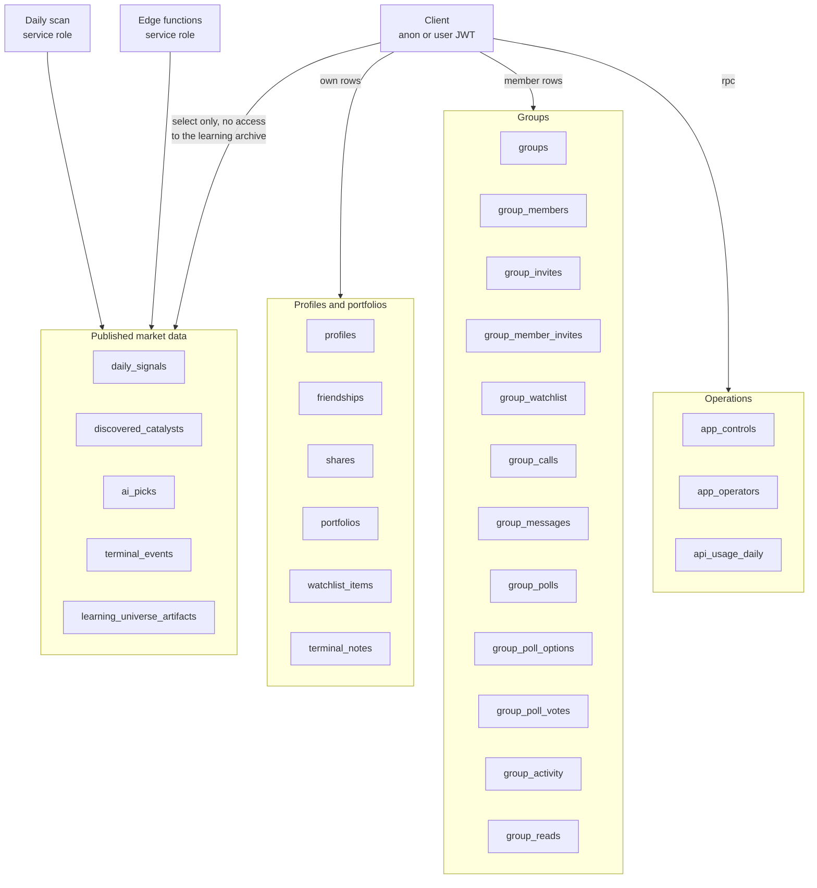
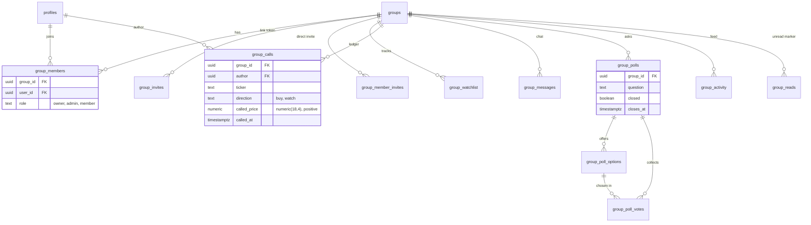

# Data model

PostgreSQL on Supabase. The 28 migrations build 26 tables, 32 SQL functions, 9 triggers, 25 secondary indexes and 6 `pg_cron` jobs. Row-level security is on for every table. Fifteen tables are in the realtime publication.

## Table groups

## Published market data

| Table | Key | Purpose | Writer |
|---|---|---|---|
| `daily_signals` | `market_day` | The ranked board as one `jsonb` array per day, with count and shape checks | Scan only |
| `discovered_catalysts` | `market_day` | Output of the grounded catalyst scan | Scan only |
| `ai_picks` | `(market_day, rank)` | Two to four daily picks with bull, bear and `skeptic` text | `ai-pick` function |
| `terminal_events` | `id` | Filing, insider and news events for the terminal | Miners |
| `learning_universe_artifacts` | `artifact_id` (digest) | Sealed candidate universe per run, append-only | Scan only |

`daily_signals` stores the board as a document because every reader wants the whole day at once and no query filters inside it. `terminal_events` is relational because readers filter by kind, ticker and time.

## Integrity rules in the database

| Rule | Enforcement | Migration |
|---|---|---|
| Declared signal count equals the array length | `check (jsonb_array_length(signals) = signal_count)` | 0007 |
| Clients cannot write the board | Insert policy dropped, grants revoked | 0013 |
| Artifact columns agree with the sealed payload | `before insert` trigger compares each field | 0027 |
| Digest is correct | Same trigger recomputes a domain-separated SHA-256 with `pgcrypto` | 0027 |
| Artifacts never change | `before update or delete` trigger raises | 0027 |
| Quarantined means inadmissible | `check (admissible = (cardinality(quarantine_reasons) = 0))` | 0027 |
| One vote per member per poll | Unique constraint plus `cast_poll_vote` RPC | 0009 |
| One settings row | `id boolean primary key default true check (id)` | 0010 |

## Groups

Membership checks used inside policies (`is_group_member`, `is_group_admin`, `are_friends`) are `security definer` functions, which avoids policies that recurse into the table they protect. The activity feed is written by five triggers on messages, calls, polls and the watchlist, so clients never write to it.

## Operations

`api_usage_daily` counts calls and failures by market day, vendor and key label through `bump_api_usage` and its batch form. The market day is computed in New York time inside the function, so every caller agrees on the boundary. `app_controls` holds pause flags, vendor budgets and the active engine variant; `set_app_controls` checks the caller against `app_operators`.

## Reading order

1. [`0007`](../supabase/migrations/0007_daily_signals.sql) then [`0013`](../supabase/migrations/0013_daily_signals_trusted_writer.sql): the board, and the migration that stopped visitors from writing to it.
2. [`0015`](../supabase/migrations/0015_pg_cron_daily_scan_trigger.sql): the scheduler and its self-guard.
3. [`0008`](../supabase/migrations/0008_groups.sql) and [`0009`](../supabase/migrations/0009_groups_chat.sql): the largest relational area.
4. [`0017`](../supabase/migrations/0017_fix_group_rpc_ambiguous_colref.sql): a repair where a PL/pgSQL output column shadowed a table column.
5. [`0027`](../supabase/migrations/0027_learning_universe_artifacts.sql): content-addressed, append-only evidence.
